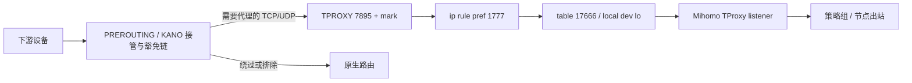

# 网络模型

## 状态来源与边界

`Policy/options.conf` 的 `traffic_mode`、`ipv6`、`dns_hijack`、`tun_stack` 与私网参数驱动接管。运行 YAML、Controller policy、API 和实际规则需一致；页面保存成功不能单独证明网络已生效。

Controller 完整源码未取得。本页的固定身份来自 JS 清理/验证契约；具体数据路径还结合历史 F50 网络快照。不能把清理器的识别规则当作完整 Controller 规则生成源码。

## IPv4 TProxy

历史 F50 快照中的接管链包含 TCP/UDP `TPROXY --on-port 7895 --on-ip 0.0.0.0 --tproxy-mark 0x10000000/0x10000000`。固定 profile 关闭 TUN 和未使用的 Redir 端口。



| 资源 | 已识别契约 | 用途 |
| --- | --- | --- |
| mark | `0x10000000/0x10000000` | 标识接管流量 |
| rule | `pref 1777 from all fwmark ... lookup 17666` | 标记流量进入插件表 |
| TProxy route | `local default dev lo table 17666 proto 242 scope host` | 本地交付 TProxy listener |
| rule | `pref 1776 from all iif lo lookup 17667` | 本地返回路径查插件回程表；TUN 模式可为 `iif KanoTun` |
| return route | 实机样本 `192.168.0.0/24 dev br0 table 17667 proto 242` | 回到下游网段；不是对所有设备固定使用该 CIDR |

归属链包括 `KANO_F50_PRE/DNS/FWD/POST/INPUT` 及已知 `KANO_POLICY*`、DNS、QUIC、MAC、私网兼容链。清理先移除外部链指向归属链的跳转，再 flush/delete 归属链；不 flush 系统表。

`ip rule show` 中 `[detached]` 是显示信息，不能原样拼到删除命令。清理器只接受规范的受管规则字段；表 `17666/17667` 被外来规则引用时应拒绝清理。`proto 242` 是受管路由识别的一部分，表号本身不足以证明归属。

## IPv4 DNS 与域名路由

托管模板使用 redir-host；`dns_hijack=on` 时接管传统 TCP/UDP 53 到 Mihomo DNS `1053`。规则不等于接管所有 DoH/DoT。

IPv6 NAT 缺失兼容路径由 `f50_ipv4_dns_rules` 管理 `KANO_F50_DNS`：先保留 TProxy 设备源地址/MAC 豁免、TUN 私网目标豁免，再添加 TCP/UDP 53 的 REDIRECT 和受管下游接口跳转。规则批量应用后再验证；只读 verify 不应悄悄重建规则。

关闭 DNS 劫持不等于禁止域名规则。代码有独立的 DNS/嗅探和域名策略处理；不能仅凭“域名规则存在”就断言 DNS 已被劫持。私网定向代理也必须按配置来源、连接网段和优先级验证。

## TUN 与 IPv6

TUN 设备为 `KanoTun`。固定 profile 关闭核心自动路由/自动重定向，由 Controller 和 Service 管理路由，`tproxy-port=0`。IPv6 profile 启用 IPv6、DNS AAAA 与双栈监听；配置的 TUN IPv6 内部地址为 `fdfe:dcba:9876::1/126`。

下游受管流量经 mark/表 `17666` 指向 KanoTun；实机策略路由快照使用 `proto 242`。转发规则需允许下游进入 TUN 和已建立连接的返回流量。实际接口及连接网段来自运行环境，不能硬编码历史运营商 IPv6 地址。

旧 Controller 会生成 mixed，Service 必须在重载前恢复选择并执行核心 `-t`；配置重载可能重建接口并移除 Controller 路由，因此重载后重新 `policy apply`、补齐回程、`policy verify`。API 读到选定 stack 仍不足以证明接管和返回流量正常。

### mixed/system IPv6 回程

Android 策略路由曾把系统栈的 SYN-ACK 发往蜂窝接口。`f50_tun6_return_route` 在 `traffic_mode=tun`、`ipv6=on`、手动 mixed/system 时读取 KanoTun 的非 link-local IPv6 前缀，并执行：

```text
ip -6 route replace <实际 TUN IPv6 前缀> dev KanoTun table 17667 proto 242
```

verify 检查 exact prefix、设备和协议，缺地址、缺路由或写入失败都阻止就绪。策略再次应用后也恢复该路由。不能把此补丁无条件应用到其他栈或关闭接管模式。

### IPv6 DNS 降级

明确确认 IPv6 NAT 表不存在时，`f50_run_controller` 保存 options，只为该次受租约保护的旧 Controller 调用暂时关闭共用 DNS 标志，调用结束恢复原偏好，再独立应用/验证 IPv4 DNS。中断后的备份需先恢复；恢复失败必须报错。

临时权限/执行错误不能当成“内核缺少 NAT”。IPv6 NAT 缺失时仍可有 IPv6 接管和解析，但无法宣称 IPv6 UDP/TCP 53 已通过 NAT 重定向。

## 设备绕过和模式切换

TProxy 使用设备绕过名单；TUN 暂停其效果但保留名单。私网目标代理与普通 LAN 豁免是不同概念，CIDR 重叠检查不能省略。`off` 停止 TProxy/TUN 接管，并在保存路径关闭 DNS 劫持；不等于卸载组件。

真实 F50 切换前应确保直接管理通道，先关闭电脑 Sparkle TUN，避免电脑与 F50 同时接管。历史实验使用独立设备恢复任务和晚于设备恢复的电脑恢复任务；这些延时是一次实验参数，不是通用固定时序。

## 历史真实 F50 验证

| 时间 / 材料 | 已验证 | 边界 |
| --- | --- | --- |
| 2026-10-11 audit.2 报告 | TProxy IPv4 透明 TCP、TCP/UDP DNS、启停；TUN IPv4 流量；双族规则/监听 | 当时 TUN 首次停止失败；下游 IPv6 TProxy 完整往返未被该报告证明 |
| 2026-10-11 audit.5 原生开机报告 | TProxy IPv4、唯一核心、API/面板 200、HTTP/SOCKS HTTPS 请求 204、受管资源一致 | 不能替代后续代码验收或 TUN/长稳测试 |
| 2026-10-13 `TUN-stack-device-validation.json` | gVisor/mips IPv4/IPv6 HTTPS 200 | mixed/system 当时 IPv6 为 000，保留历史失败 |
| 同日 `Auto-MIPS-device-validation.json` | 自动 mips，IPv4/双栈选择及 IPv6 HTTP 200 | 指定设备和核心样本 |
| 同日 `IPv6-return-route-final-validation.json` | 修复后 system/mixed/gVisor/auto IPv4、固定 IPv6 地址及 DNS 获取 IPv6 的 HTTP 均 200；system/mixed 策略重应用验证 | 定向连接测试，不证明所有 UDP、重启或长期稳定性 |

原始材料保存在仓库外，定位见 [AUDIT_HISTORY](AUDIT_HISTORY.md)。本次没有切换设备或重新执行网络实验。

来源：[主插件](../猫猫TProxy.js)的 profile、NetworkHelpers、Tun6Compat、Ipv6DnsCompat、KPR；[IPv6 测试](../tests/tproxy/ipv6_dns.test.js)、[网络归属测试](../tests/tproxy/optimization_network.test.js)及上述原始历史记录。
