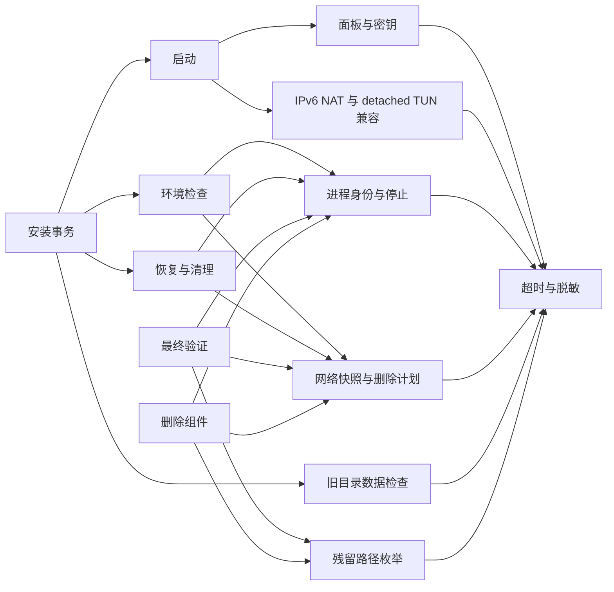

# 猫猫 TProxy 优化交付

## 文件与基线

- 完整插件：`猫猫TProxy_Optimized.js`。可作为单文件插件替换原版，运行时没有新增依赖。
- 原文件：`猫猫TProxy.js`，保持不变。工作区不存在任务文本中的时间戳文件名，使用这个同版本文件建立基线。
- 完整源码差异：`猫猫TProxy_Optimized.diff`。
- 后端兼容版本仍为 `8.0.0-compat.2.3`；固定默认 secret 仍为 `123456`。原有非空 secret 保留。
- 许可证、作者声明、端口、磁盘路径和单文件入口保持原样。

基线：`node --check 猫猫TProxy.js` 通过；主测试 100 项通过；订阅测试初次运行 15 项通过、2 项因未指定 yq 跳过。随后使用 Mike Farah yq v4.47.2 完成优化版全部 YAML 与服务包装器测试。

## 实际修复

| 项目 | 原因与修复 |
| --- | --- |
| P0-1 安装错误码 | 命令替换隔离了启动变量。外层从脱敏输出一次解析行首锚定的最后有效 code、OK 和 RC，保存完整 detail；没有有效 code 时使用 `service_failed`，保留原 Shell 返回值。安装事务能收到超时、配置、面板、网络和包装器修补失败的准确诊断。 |
| P0-2 转换模式 | 去除两个固定 local 返回值，读取模式标记；无有效标记时依据实际 Provider 类型推断，全新配置默认 provider。保存、恢复、迁移、配置编辑及运行配置重建继续传递所选模式。 |
| P0-2 HTTP 更新 | 去除 HTTP Provider 更新拒绝分支，通过 Mihomo PUT/GET 更新并检查可用节点；保留两路并发限制。390 识别可以进入本地回退。原配置走完整订阅下载流程，自定义配置保持 Provider 更新保护。 |
| P0-2 服务准备 | 明确标记为模板 provider 模式时，服务包装器在控制器准备后恢复原 HTTP Provider 定义与 User-Agent，移除这次本地迁移生成的远程元数据，再做核心配置校验和加载。local、原配置、自定义配置的旧处理保留。包装器维护标记升级至 11；后端版本与校验没有改变。 |
| P0-2 390 回退 | 复用已有订阅保存事务，覆盖模式、运行配置、模板、节点缓存和运行状态。下载、写入、启动、加载失败会恢复对应快照；恢复失败保留事务备份。 |
| P1-1 取消 | 重抛 `OperationCancelled`；每次 Shell 调用前、返回后及退避前后检查原操作 token。普通错误仍按三次尝试及 800/1600 ms 退避处理；取消不显示安装或订阅失败提示。 |
| P1-2 停止状态 | 仅旧安装存在停止标记且核心未运行时保持停止，返回 `installed_stopped`。新安装、运行中升级及没有明确停止标记的安装保留原启动行为。回滚仍保留旧进程与停止标记语义。 |
| P1-3 YAML 写入 | 面板字段已正确时不重写。需要修复时写旁侧临时文件、验证映射、设为 600 后原子替换；原配置保留 unified-delay。非空密钥不被覆盖，空密钥补固定值。服务包装器的面板修复也先检查字段，且两条分支都保留核心校验与 API 加载。原配置合并结果字节相同时不再替换。 |
| P1-4 yq | 共用可执行性、Mike Farah 身份和 v4 检查；YAML 读取在同一个 Shell 请求中完成一次版本检查和解析，不使用持久缓存。文件大小、超时、JSON 转换和根映射检查保留。 |
| P2-1 Shell 模块 | 将维护代码拆为 12 个职责模块，由一个组合器按操作选择传递依赖。网络清理和进程身份函数未改动，卸载及最终验证仍不依赖待卸载目录中的辅助程序。 |
| P2-2 文件事务 | 订阅保存复用现有文件快照与恢复函数；390 回退复用订阅事务。安装目录事务和配置热加载回滚仍保持独立，不混用恢复语义。相同 YAML 提交时避免计算无用的暂存文件哈希及大小。 |
| P2-3 UI | 14 处按钮操作共用锁与 busy 状态包装器，`finally` 恢复按钮并释放锁。DOM ID、事件入口数量、显示隐藏逻辑和输入流程保留。订阅恢复的模板分支复用更新函数。 |

## 依赖关系

组合器的模块关系如下。每个模块的内部 Shell 函数名仍与原版一致，启动的间接调用和卸载所需恢复功能均保留。



启动错误码的路径为 `buildF50StartScript → f50_start_service → 外层标记解析 → f50_install_fail → f50Diagnostic`。订阅回退的路径为 `updateSubProviders / saveSubSources → switchHttpProviderToLocal → saveSubSources(local) → 文件快照及失败恢复`，local 分支不会再次触发 HTTP 回退。

## 数量与设备开销

| 项目 | 原版 | 优化版 |
| --- | ---: | ---: |
| JS 行数，不计末尾空行 | 10,790 | 10,816 |
| 完整文件字节数，均保留 CRLF | 550,477 | 553,009 |
| 具名 buildF50 生成函数 | 10 | 23 |
| 维护模板中的唯一 f50 Shell 函数名 | 30 | 32 |
| 重复按钮锁与 busy 处理块 | 14 | 1 个共用包装器 |
| 独立订阅回退事务实现 | 2 套 | 1 套订阅事务 |
| 单次 YAML 读取的版本查询 | 2 | 1 |
| 单次 YAML 读取的根 Shell 请求，不计共同后端检查 | 2 | 1 |

源码增加 26 行、2,532 字节，用于完整修复、原子写入、模式保护和明确依赖组合。没有压缩变量名或代码行来制造缩减。

以下为生成脚本实际 UTF-8 字节数，参数统一为 `start` 和 `/data/upload.zip`。卸载统计所有阶段发送文本之和；没有用真机耗时推算性能。

| 操作 | 原版 | 优化版 | 减少 |
| --- | ---: | ---: | ---: |
| 启动 | 35,362 | 19,031 | 46.2% |
| 环境检查 | 35,132 | 13,538 | 61.5% |
| 安装 | 50,839 | 48,945 | 3.7% |
| 恢复清理 | 35,288 | 15,545 | 55.9% |
| 最终验证 | 35,542 | 17,403 | 51.0% |
| 卸载阶段合计 | 70,838 | 32,165 | 54.6% |

正常面板检查从改写文件变为只读检查；实际需要修复时增加暂存与验证，保留稳定性。安装事务及配置热加载的独立备份机制没有强行合并；网络、fwmark、路由表和防火墙算法也没有改写。

## 自动化测试

最终结果：**197 项通过，0 项失败，0 项跳过**。其中原主测试 100 项、原订阅测试 17 项、新增测试 80 项。

| 测试文件 | 通过数 | 主要覆盖 |
| --- | ---: | --- |
| `tests/tproxy/run_tests.js` | 100 | 版本、安装安全约束、面板身份、包装器、网络兼容、配置、诊断 |
| `tests/tproxy/subscription_update.test.js` | 17 | 原配置保留、重复键、核心校验、包装器 1–10 迁移；provider 在 prepare/start/restart/boot 后保留，正确面板不重写且仍通过核心校验 |
| `tests/tproxy/optimization.test.js` | 25 | 完整 JS、各生成 Shell 的 sh -n、六种配置逐字段一致、启动错误码、模式、取消、yq 替换/缺失/不兼容、大小及解析失败、YAML 原子修复 |
| `tests/tproxy/optimization_install.test.js` | 16 | 首次安装、运行/停止升级、非法 ZIP 路径、缺少组件、无效配置、超时、面板/网络/包装器失败、旧安装恢复和备份保留 |
| `tests/tproxy/optimization_subscription.test.js` | 20 | provider/local 保存与更新、模式不匹配重建、HTTP 390、下载/写入/启动/加载失败恢复、多订阅及全禁用、自定义和原配置保护 |
| `tests/tproxy/optimization_network.test.js` | 19 | 网络函数原文一致、IPv4/IPv6 CIDR、重叠、IPv6 限制、TUN/私网重复应用及关闭恢复、异应用规则保护、残留状态、UI 控件及锁释放 |

执行命令（PowerShell，`F50_TEST_YQ` 指向测试机可执行的 Mike Farah yq v4）：

```powershell
$env:F50_PLUGIN = '猫猫TProxy_Optimized.js'
$env:F50_TEST_YQ = (Resolve-Path '.codex/yq-test.exe').Path
node --check 猫猫TProxy_Optimized.js
node tests/tproxy/run_tests.js
node --test tests/tproxy/subscription_update.test.js tests/tproxy/optimization.test.js tests/tproxy/optimization_install.test.js tests/tproxy/optimization_subscription.test.js tests/tproxy/optimization_network.test.js
```

测试用 yq 位于本机 `.codex/yq-test.exe`，不随插件提交，也不是新增 F50 运行依赖。Shell 生成语法和故障模拟由 Node 测试实际调用 POSIX `sh`。测试隔离在临时目录，网络规则用快照文本与模拟结果验证，没有执行开发机真实 iptables 或路由修改。

## 需要 F50 真机验证

- 真实组件 ZIP 解压、ARM 内核/yq/控制器执行，以及安装中断、存储不足和故障回滚。
- 原停止状态升级、运行中升级、开机自启、卸载后进程/链/路由/KanoTun 的最终残留检查。
- 六种接管模式的真实 IPv4/IPv6 DNS、设备绕过、SNAT、QUIC、私网定向代理及网络救援。
- 真实订阅的 HTTPS 下载与地址固定、多订阅、分享链接转换、禁用状态、HTTP Provider 更新及上游 390 的实际回退。
- Zashboard 实际 HTTP 身份、控制接口加载与节点可用性；连续启动时整个 config.yaml 的写入次数，包括兼容控制器自身的配置整形。
- 浏览器中反复打开/关闭订阅、规则、配置及网络弹窗，以及取消操作与设备通信超时的交互。

离线测试证明配置生成、Shell 组合、字段保护和模拟失败恢复；没有把这些结果当作 F50 实际网络或硬件运行证明。
